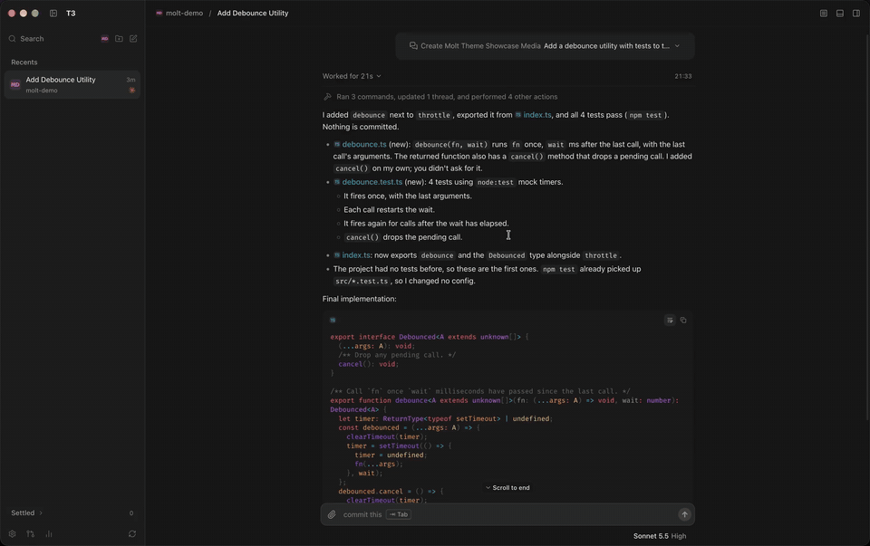
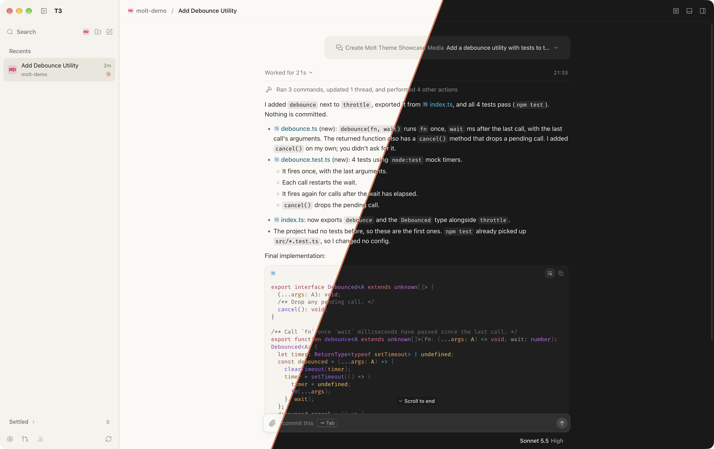
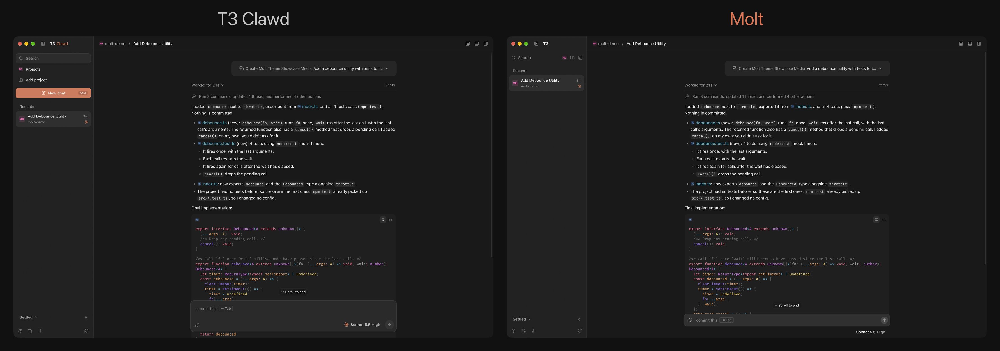

# Molt

A warm theme for [T3 Code](https://github.com/pingdotgg/t3code). It has a terracotta accent, a cream light mode and a charcoal dark mode.

Molt grew out of [T3 Clawd](https://github.com/rohit3a/t3-clawd) by [@rohit3a](https://x.com/rohit3a). It reworks the original's surfaces, composer, banners and layering, much as a crab sheds its shell and grows a new one.



## Install

```sh
curl -fsSL https://raw.githubusercontent.com/SimianW/t3-molt-theme/main/molt.json \
  -o ~/.t3/userdata/themes/molt.json
```

Then choose **Molt** in T3 Code's theme settings. Molt follows your system appearance and includes both a light and a dark mode.

## Screenshots



**T3 Clawd → Molt** (dark)



## Credits

- Based on [rohit3a/t3-clawd](https://github.com/rohit3a/t3-clawd).
- The palette is inspired by Claude's warm tones. Molt is unofficial and not affiliated with Anthropic.

## License

MIT
